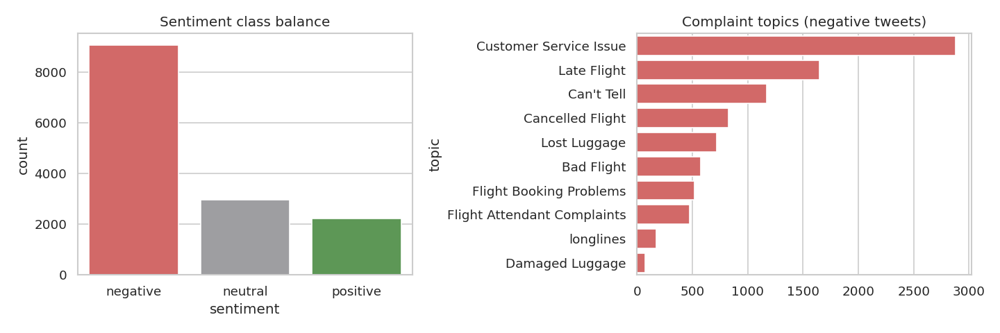
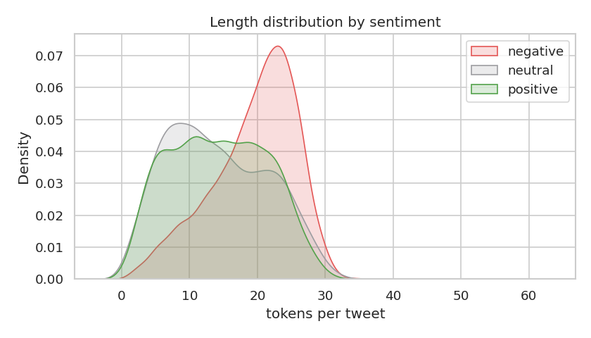
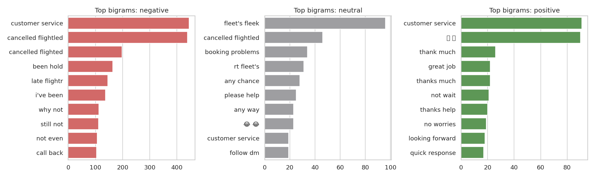
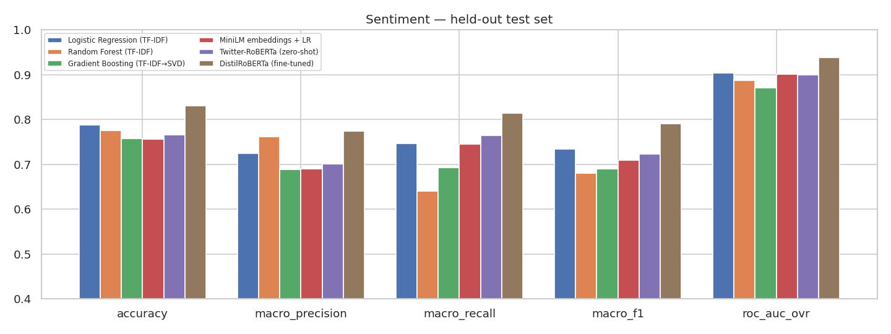
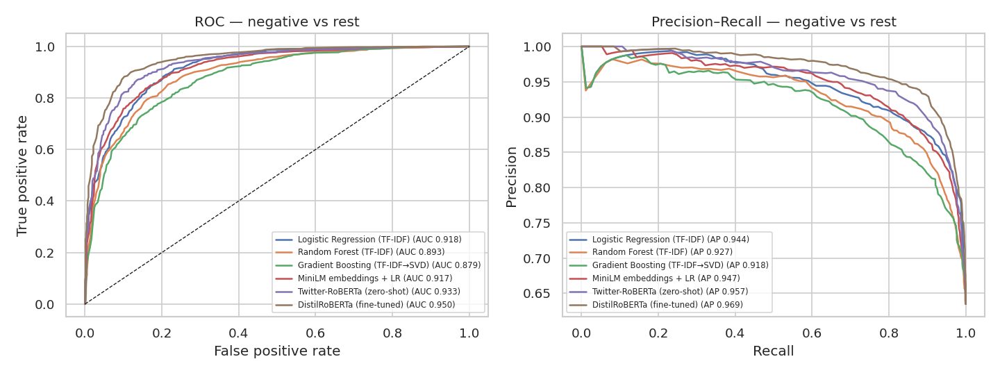
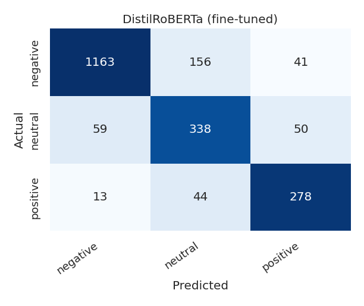
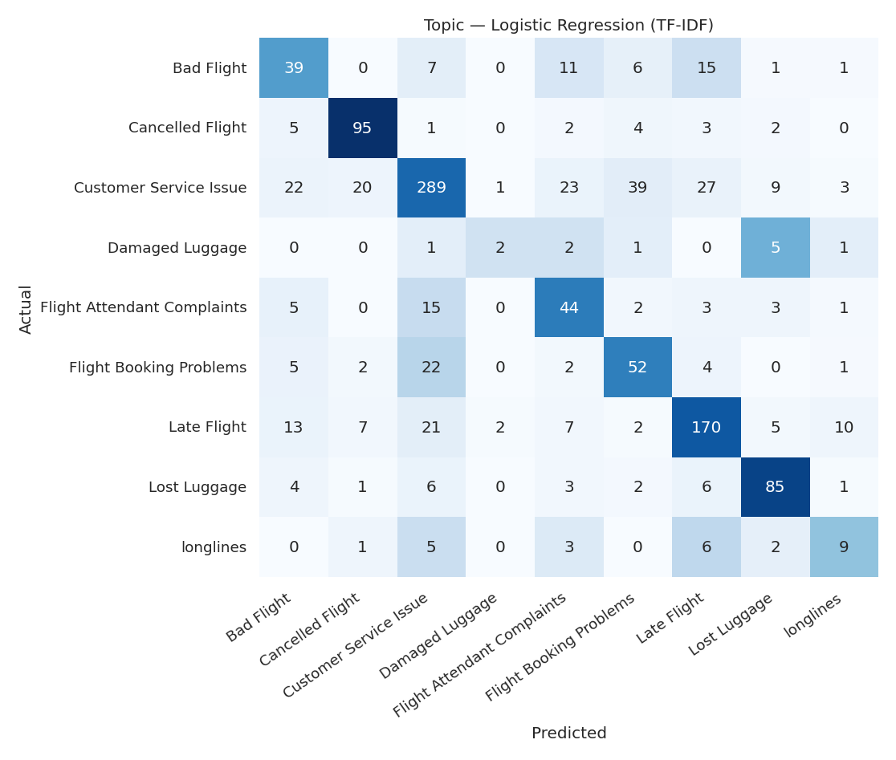
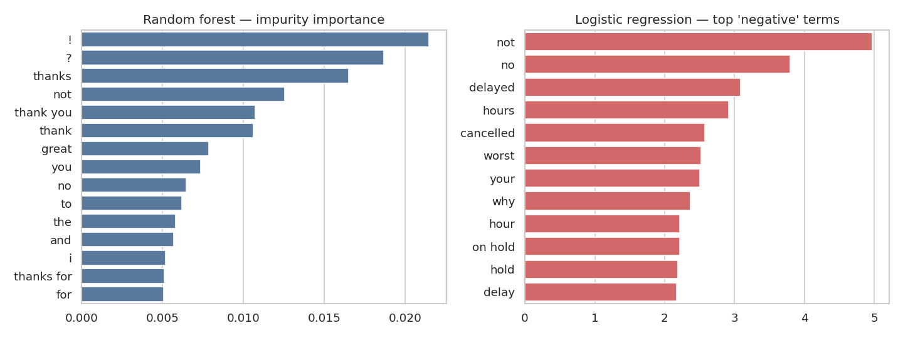
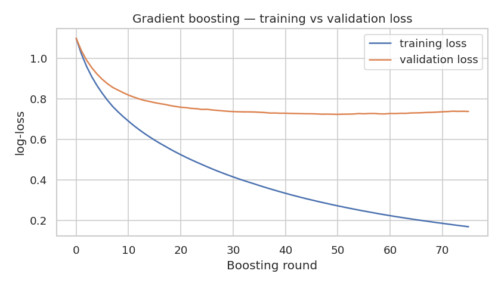

# Sentiment Analysis & Text Classification

Classifying customer feedback by **sentiment** and **complaint topic** to surface what users care about.

**Live demo:** https://syndoukone.github.io/sentiment-text-classification/ (static site in [`docs/`](docs/) — the trained baseline runs in the browser)

| Task | Best model | Test macro-F1 (95% CI) | Accuracy |
|---|---|---|---|
| Sentiment (neg / neu / pos) | DistilRoBERTa, fine-tuned | **0.791** (0.771–0.811) | 83.1% |
| Sentiment — classic baseline | TF-IDF + logistic regression | 0.734 (0.712–0.755) | 78.8% |
| Complaint topic (9 classes) | TF-IDF + logistic regression | **0.566** (0.522–0.607) | 67.2% |

---

## 01 · Problem & business context
Airlines receive thousands of tweets a day and most go unread. Sentiment labels turn that stream into a measurable signal; topic labels on complaints
(late flight, lost luggage, customer service, …) say *what* to fix. Consumers: social-media care teams (triage negative tweets first) and
ops / CX managers (weekly complaint-driver dashboards per airline).

## 02 · Dataset & sources
**Twitter US Airline Sentiment** (CrowdFlower / Figure Eight, Feb 2015, CC BY-NC-SA 4.0), loaded from Hugging Face
[`osanseviero/twitter-airline-sentiment`](https://huggingface.co/datasets/osanseviero/twitter-airline-sentiment): 14,640 tweets to 6 US airlines.

- **Task A — sentiment**: `negative` / `neutral` / `positive`.
- **Task B — topic**: the `negativereason` of negative tweets (10 labels; `Can't Tell` dropped → 9 classes, 7,899 tweets).

## 03 · Cleaning & preprocessing ([`stc/text.py`](stc/text.py), [`stc/data.py`](stc/data.py))
- HTML-entity decoding, lower-casing, curly-quote normalisation.
- URL removal; **@handle removal** (handles name the airline and would leak it into the model).
- Negation-preserving contractions (`can't → can not`, `n't → not`); no stop-word removal.
- Regex tokenisation keeping words, `!`, `?` and emoji.
- Exact-duplicate removal after cleaning: 364 rows → 14,276 tweets, so no copy sits in both train and test.
- Language detection (`langdetect`): 84 tweets flagged non-English, but manual review showed they are English slang/emoji
  ("sounds like fun !", "i ❤️ flying"), so the flag is stored, **not** used as a filter.

## 04 · Exploratory data analysis
Imbalanced classes — negative 63.5%, neutral 20.8%, positive 15.6%. Negative tweets are longer (median 21 vs 14 tokens).
Top negative bigrams: "customer service", "cancelled flightled" (artefact in the source text), "been hold".





## 05 · Feature engineering
- **Sparse**: TF-IDF word uni+bi-grams (min_df=2, sublinear tf, 20k features).
- **Dense**: TF-IDF → TruncatedSVD(300) for gradient boosting.
- **Contextual**: frozen `all-MiniLM-L6-v2` sentence embeddings (384-d); full fine-tuning of `distilroberta-base` with its own sub-word tokeniser.

## 06 · Model selection
| Model | Val macro-F1 | Test macro-F1 [95% CI] | Accuracy | ROC-AUC (OvR) |
|---|---|---|---|---|
| Logistic Regression (TF-IDF, C=1) | 0.749 | 0.734 [0.712, 0.755] | 78.8% | 0.903 |
| Random Forest (TF-IDF, 400 trees) | 0.686 | 0.680 [0.654, 0.704] | 77.6% | 0.887 |
| Gradient Boosting (TF-IDF→SVD) | 0.696 | 0.690 [0.668, 0.713] | 75.8% | 0.871 |
| MiniLM embeddings + LR | 0.742 | 0.709 [0.687, 0.731] | 75.6% | 0.901 |
| Twitter-RoBERTa (zero-shot) | — | 0.723 [0.703, 0.744] | 76.6% | 0.900 |
| **DistilRoBERTa (fine-tuned)** | **0.803** | **0.791 [0.771, 0.811]** | **83.1%** | **0.939** |

## 07 · Training & validation
Stratified 70/15/15 train/val/test split (seed 42). `C` for the linear models and the fine-tuning epoch are picked on **validation macro-F1**;
the test set is used once. Class-balanced weights everywhere (balanced `class_weight`, weighted cross-entropy for the transformer).
Fine-tuning: 3 epochs, lr 3e-5, max_len 64, batch 32 — 56 min on 2 CPU cores.

## 08 · Evaluation metrics
Macro-F1 (headline), per-class recall, confusion matrices, one-vs-rest ROC-AUC, and 1,000-resample bootstrap 95% CIs on macro-F1.




## 09 · Results
**Sentiment** — per-class recall:

| Model | negative | neutral | positive |
|---|---|---|---|
| Logistic Regression (TF-IDF) | 84.0% | 67.8% | 72.2% |
| DistilRoBERTa (fine-tuned) | 85.5% | **75.6%** | **83.0%** |

Fine-tuning gains +0.057 macro-F1 over the baseline (non-overlapping 95% CIs), mostly on neutral and positive tweets.

**Topic** (negative tweets, 1,169 test tweets) — LR recall per topic: Cancelled Flight 85%, Lost Luggage 79%, Late Flight 72%,
Customer Service 67%, Flight Attendant 60%, Booking Problems 59%, Bad Flight 49%, longlines 35%, Damaged Luggage 17% (n=12).

 

## 10 · Limitations
- **Sarcasm & mixed tweets**: "great, another 3 hour delay. love it." is scored positive by the bag-of-words baseline.
- **Label noise**: crowd labels; most confident baseline errors are short "thanks!" tweets or detailed complaints labelled *neutral*.
- **Domain shift**: one week of 2015 US-airline tweets.
- **Multilingual text**: English-only model; language ID is unreliable on short texts.
- Rare topics (Damaged Luggage, longlines) have too few examples for reliable recall.

## 11 · Lessons learned
- A tuned TF-IDF + LR baseline beats tree ensembles, frozen embeddings and a zero-shot Twitter model — and is small and explainable.
- Only **fine-tuning** a transformer clearly beats it; the gain is concentrated on the hard neutral class.
- Preprocessing choices are leakage choices: drop @handles (airline leakage) and duplicates (train/test leakage).
- Validate tools like language detection by eye before using them as filters.
- Macro-F1 + per-class recall expose the weak classes that accuracy hides.




---

## Reproduce
```bash
pip install -r requirements.txt
python -m stc.finetune      # optional, ~1 h on CPU → reports/finetune.json
python -m stc.train         # EDA, all models, figures, docs/assets/*.json (~5 min)
python -m pytest -q tests
cd docs && python -m http.server 8000   # open http://localhost:8000
```

```
stc/        text cleaning, data loading/splits, EDA, metrics, training, fine-tuning
reports/    metrics.json, finetune.json, figures/
docs/       static demo site (GitHub Pages): index.html, app.js, assets/{results,model}.json
tests/      unit tests for text processing
```
